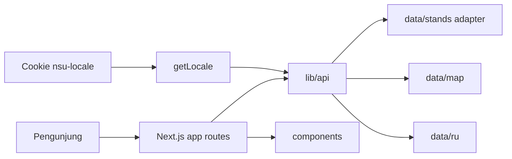

# SPUTNIK — arsitektur integrasi 36 stand dan EN/RU

## Prinsip

Kode ini merupakan pembaruan **prototipe**. Satu data akses (`src/lib/api/index.ts`) dipakai untuk membaca data; komponen UI tidak mengakses database secara langsung. Sistem bahasa Rusia mengikuti `nsu-locale` melalui server. Peta tetap 1000 × 680, dengan 36 stand; tidak diganti dengan versi `main` 1000 × 820.

## Peran folder

| Lokasi | Peran | Diubah ketika |
|---|---|---|
| `src/app/` | routing server, metadata, locale | jenis halaman bertambah |
| `src/components/map/FestivalMap.tsx` | peta SVG, popup, filter, zoom | desain atau perilaku peta berubah |
| `src/data/map/stand-positions.ts` | koordinat sumber A, ukuran marker, panggung | stand dipindah |
| `src/data/map/layout.ts` | canvas dan transformasi seragam | ukuran canvas berubah |
| `src/data/map.ts` | adapter posisi dan fasilitas | jenis fasilitas berubah |
| `public/maps/nsu-courtyard.svg` | latar Minecraft terbaru | desain taman berubah |
| `src/data/countries/list.ts` | 35 profil peserta untuk 36 stand | nama, nomor, warna atau bendera berubah |
| `src/data/countries/map-identities.ts` | kode singkat pada peta | label peta berubah |
| `src/data/stands.ts` | adapter dari country ke model stand | tipe dan penerjemahan stand diperluas |
| `src/types/stand.ts` | bentuk data stand | schema konten berubah |
| `src/app/stand/[slug]/page.tsx` | halaman semua stand | halaman stand berubah |
| `src/components/stand/StandDetail.tsx` | tampilan bilingual stand | UI stand berubah |
| `src/data/countries/<slug>/` | isi negara khusus (kuis, makanan, eksplorasi) | ada konten baru |
| `src/lib/api/index.ts` | pintu akses data | migrasi CMS/PostgreSQL |
| `src/lib/i18n/` | cookie dan kamus UI EN/RU | terjemahan label/tombol berubah |
| `src/data/ru/` | terjemahan nama stand, jadwal dan fasilitas | terjemahan data berubah |

## Dua URL berbeda

- `/stand/[slug]`: berlaku untuk semua stand, organisasi dan paviliun tematik, dengan informasi dasar.
- `/country/[slug]`: halaman budaya mendalam; tidak semua negara memiliki isi penuh. Halaman stand negara menyediakan tautan ke sini.

## Alur bahasa

1. Pengunjung memilih EN atau RU lewat `LanguageSwitcher`.
2. Provider menyimpan cookie `nsu-locale`, lalu me-refresh route.
3. `getLocale()` di server membaca cookie tersebut.
4. `lib/api` menerjemahkan data dasar; kamus UI di `lib/i18n` menerjemahkan label.
5. `getStandDetail` menerjemahkan metadata stand; jika belum ada RU, teks EN dipakai dengan pemberitahuan.

## Prosedur perubahan

1. Tambah identitas di `src/data/countries/list.ts`, koordinat di `src/data/map/stand-positions.ts`, kode di `map-identities.ts`.
2. Jika stand bukan negara, klasifikasikan di `src/lib/stand.ts`.
3. Tambahkan data Rusia di `src/data/ru/countries.ts`; review terjemahan bersama perwakilan stand.
4. Untuk konten budaya yang terverifikasi, tambahkan folder negara pada `src/data/countries` dan daftarkan di `content.ts`.
5. Jalankan `npm run verify:data`, `npm run typecheck`, `npm run build`.

## Batasan saat ini

Belum ada CMS yang berjalan, autentikasi administrator, database produksi, ataupun penukaran kode hadiah yang aman. Data budaya dan nama organisasi harus dikonfirmasi penyelenggara. Latar `nsu-courtyard.svg` diambil dari paket peta final. Koordinat mengikuti keputusan terbaru: Versi A 1480 × 1200 diperkecil seragam ke 1000 × 680, bukan koordinat alternatif dalam paket peta final. Posisi A dan latar paket terakhir berasal dari revisi berbeda; kesesuaian visual dengan denah lokasi perlu ditinjau.

## Identitas dan sumber revisi

- Basis: branch `update-peta-36-negara` (`e157280`) digabung dengan `main` (`703d8ef`).
- Pembaruan arsitektur: `SPUTNIK_Architecture_Update.zip`.
- Ground: `nsu-courtyard.svg` dari paket final 1000 × 680; SVG disimpan sebagai aset sendiri, tanpa menduplikasi pohon/taman dalam React.
- Koordinat: seluruh 36 titik A yang disetujui di chat; transformasi tidak membulatkan koordinat sehingga rasio jarak tetap tepat.
- China memiliki stand 15 dan 16: `/stand/china-15` dan `/stand/china-16`; budaya bersama `/country/china`. URL lama `/stand/china` diarahkan ke stand 15.
- Nomor Indonesia 17; Tea Pavilion 36. Placeholder unassigned-36 dihapus dari daftar aktif.
- `src/lib/stand.ts` memusatkan klasifikasi dan aturan slug. Stand dibentuk dari posisi fisik, bukan jumlah profil negara.
- Domain runtime dan deployment kampus: lihat `DEPLOYMENT-ID.md`.

Perubahan yang hanya tersimpan di laptop atau stash pengguna tidak bisa dibaca dari clone GitHub; penggabungan ini menggunakan kode GitHub dan paket yang tersedia dalam percakapan.
